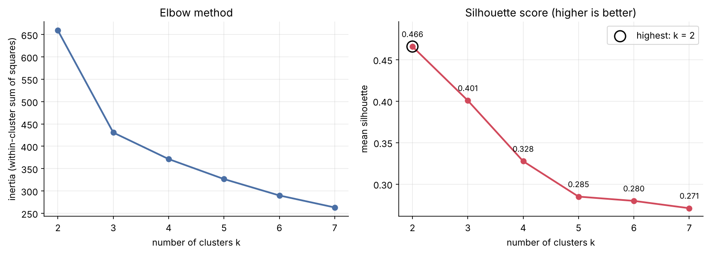
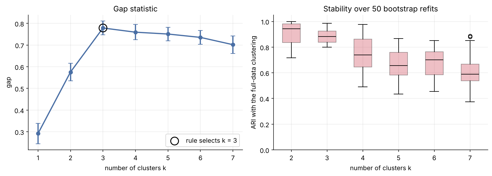
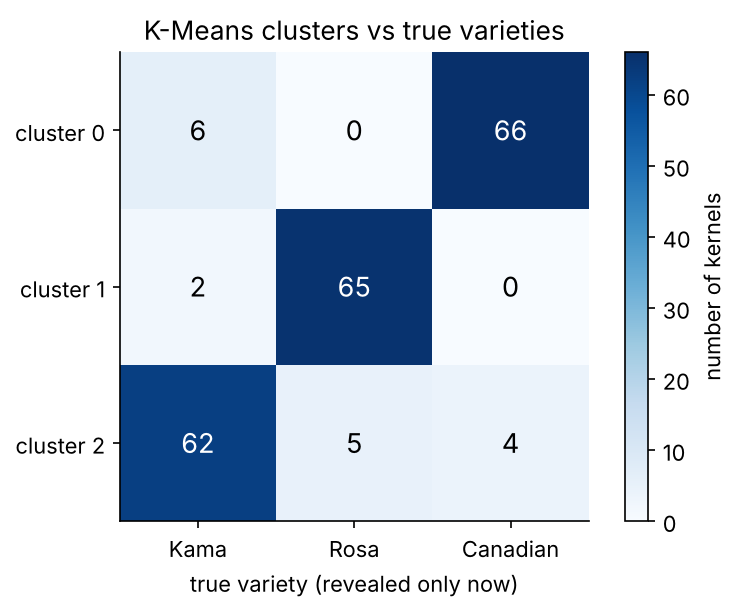
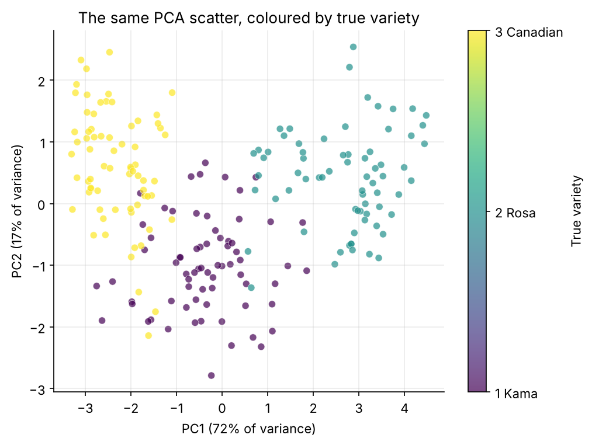
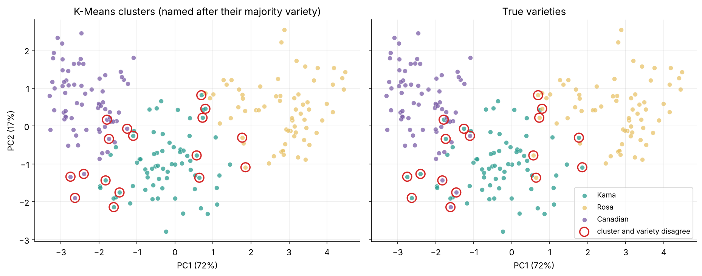
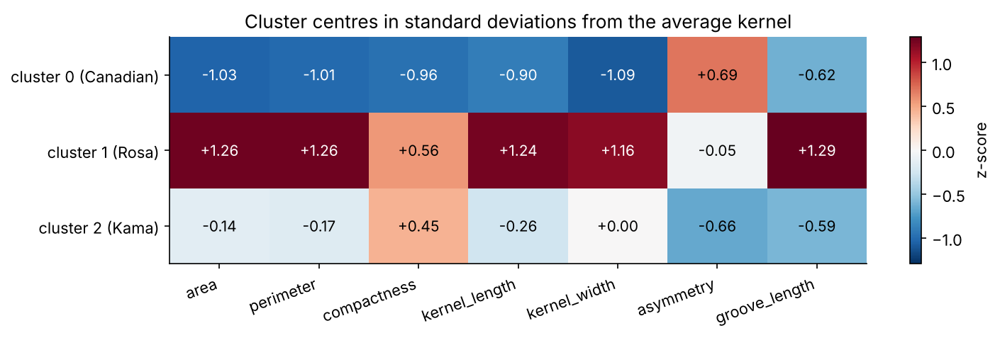
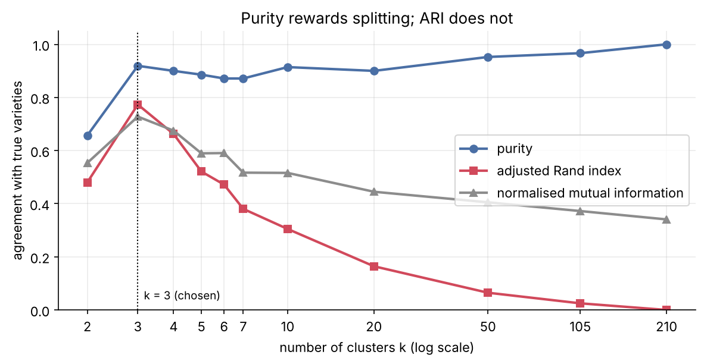

# How much structure can clustering find without labels?

**Final project, Option 3. Machine Learning with Python (LEAP)**
Author: **Andreou Maria-Gavriela**

I took 210 wheat kernels, hid their variety labels, and asked how much of the real grouping K-Means clustering could recover from seven simple measurements. I only brought the labels back at the very end, as an answer key.

**Main result:** the data support **three groups**. **193 of the 210 kernels (purity 0.919)** fall in a cluster dominated by their own variety. The chance-corrected scores agree: **ARI 0.773** and **NMI 0.728**. The structure is real, but its boundaries are soft. Every one of the 17 misplaced kernels involves the middle-sized variety, Kama.

| File | What it is |
|---|---|
| [`Final_Project_Option3_Seeds_Clustering.ipynb`](Final_Project_Option3_Seeds_Clustering.ipynb) | The completed notebook, with all cells run and all outputs visible |
| [`report/Final_Project_Option3_Seeds_Clustering.pdf`](report/Final_Project_Option3_Seeds_Clustering.pdf) | PDF export of the notebook (code, outputs and written answers) |
| [`report/Final_Project_Option3_Seeds_Clustering.html`](report/Final_Project_Option3_Seeds_Clustering.html) | HTML export of the notebook, which opens in any browser |
| [`index.html`](index.html) | One-page visual summary of the project, served as the website when GitHub Pages is switched on |
| [`figures/`](figures) | Every chart, saved by the notebook |
| [`data/seeds.csv`](data/seeds.csv) | A copy of the UCI Seeds data, so the notebook also runs offline |

---

## 1. Problem

An agricultural co-op receives deliveries of mixed wheat grain without labels. Before paying for a sorting process, it wants to know two things: **how many varieties are plausibly present, and how cleanly do they separate** on a few cheap measurements?

I treat this as an **unsupervised** problem. I cluster the kernels without ever looking at their variety, and only afterwards check how much of the real class structure the clusters recovered.

## 2. Data

The data are the **Seeds** data set from the UCI Machine Learning Repository (Charytanowicz et al., 2010; CC BY 4.0). It describes **210 kernels**, 70 from each of three wheat varieties: **Kama, Rosa and Canadian**. The grain was harvested from experimental fields at the Institute of Agrophysics of the Polish Academy of Sciences in Lublin. Each kernel was imaged with a soft X-ray technique, and seven geometric measurements were taken from the image:

| Feature | Meaning |
|---|---|
| `area`, `perimeter` | Size of the kernel's outline |
| `compactness` | 4πA / P², or how close the outline is to a circle |
| `kernel_length`, `kernel_width` | Main dimensions of the kernel |
| `asymmetry` | Asymmetry coefficient of the shape |
| `groove_length` | Length of the kernel groove |

All seven are continuous, with no missing values. The notebook downloads the data from OpenML as the course intended. If a copy is present in `data/seeds.csv`, it uses that copy instead. I checked that this copy is identical to a second independent mirror of the UCI file: 210 rows, 70 kernels per class.

## 3. Method

1. **Scaling.** I put all features on a common scale with `StandardScaler`. Area is measured in units of about 10–20 and compactness of about 0.8–0.9, so without scaling, area would dominate every distance.
2. **Exploration without labels.** I used PCA to reduce the data to 2 components for plotting. Together they keep **89%** of the variance: PC1 (72%) is a *size* axis and PC2 (17%) a *shape* axis that contrasts asymmetry with compactness.
3. **Choosing k without labels.** I fitted K-Means for k = 2 to 7 (`n_init=10`, `random_state=42`) and compared four signals:
   - the **elbow** (inertia);
   - the **silhouette** score;
   - the **gap statistic** (Tibshirani et al., 2001), *extension*;
   - **bootstrap stability**, where I refit on 50 resamples and compare the partitions with the adjusted Rand index, *extension*.
4. **Final model.** K-Means with **k = 3**, fitted on all seven scaled features.
5. **Validation against the hidden labels.** This step comes only after the clustering was fixed. I used:
   - a cross-tabulation and a **purity** score;
   - per-variety recall and precision;
   - the chance-corrected **ARI** and **NMI**, and how all these scores behave as k grows;
   - an analysis of the kernels the clustering placed with the "wrong" variety.
6. **Interpretation and robustness.** I described each cluster by its centre in original units and in z-scores. I also re-ran the analysis with Ward hierarchical clustering, a Gaussian mixture model and 25 random seeds.

## 4. Results

### How many clusters?



The two course diagnostics **disagree**:

- **Elbow: k = 3.** The elbow is sharp at 3: inertia drops by 229 from k = 2 to 3, but only by 59 from 3 to 4.
- **Silhouette: k = 2.** The silhouette is highest at k = 2 (0.466), with k = 3 close behind (0.401). The k = 2 solution simply merges two neighbouring groups into one of 133 kernels.



To settle this without peeking at the labels, I added two more checks:

- **Gap statistic: k = 3.** It selects **k = 3**.
- **Bootstrap stability: k ≥ 4 is unstable.** Three clusters are about as reproducible as two (mean ARI 0.88 against 0.92, with a tighter lower tail), while from k = 4 the partitions break down (mean ARI ≤ 0.75).

I therefore chose **k = 3**.

### How well do the clusters match the real varieties?



| Variety | Kernels recovered | Recall | Precision of its cluster |
|---|---|---|---|
| Rosa | 65 / 70 | 0.929 | **0.970** |
| Canadian | 66 / 70 | 0.943 | 0.917 |
| Kama | 62 / 70 | 0.886 | 0.873 |
| **Overall** | **193 / 210** | **purity 0.919** | **ARI 0.773, NMI 0.728** |

- **Rosa** separates most cleanly. It is never confused with Canadian.
- **Kama and Canadian** are the hardest pair to tell apart (10 kernels swapped), followed by Kama and Rosa (7).



Seen in the PCA view, the varieties line up along the size axis: Canadian on the left, Kama in the middle overlapping both neighbours, and Rosa on the right.

### Which kernels end up in the "wrong" cluster?



The 17 disagreements are **mostly borderline kernels**:

- **They sit near the boundaries.** Their median margin (how much closer the nearest centre is than the second-nearest) is 0.41, against 1.94 for the other kernels. 11 of the 17 fall among the 15% of kernels with the smallest margins.
- **Every one involves Kama.**
  - Kama kernels that are small or asymmetric were grouped with Canadian.
  - Large Kama kernels were grouped with Rosa.
  - The reverse also happens: a few Kama-like Rosa and Canadian kernels were grouped with Kama.

### What does each cluster represent?



| Cluster | Majority variety | Typical kernel |
|---|---|---|
| 1 | Rosa | **Large**: about 1.2–1.3 SD above average on every size measure (area 18.5) |
| 2 | Kama | **Medium and compact**: low asymmetry (2.7), short groove |
| 0 | Canadian | **Small, narrow, least compact**: the highest asymmetry (4.7) |

The cluster centres almost coincide with the true variety means. For area, for example: 11.86 against 11.87 for Canadian, 14.44 against 14.33 for Kama, and 18.50 against 18.33 for Rosa.

### Is the structure real?

- **Other algorithms find the same three groups.** Ward clustering reaches purity 0.929 and ARI 0.797, and agrees with my K-Means clusters at ARI 0.836. A Gaussian mixture reaches purity 0.895 and ARI 0.723.
- **K-Means does not depend on its random start.** It gives the *identical* partition for 25 different random seeds.
- **Purity alone is not proof.** It increases as the data are split into more and more clusters and reaches 1.0 at one kernel per cluster. ARI, by contrast, peaks at k = 3 and falls to 0:



## 5. Interpretation and limitations

Without labels, K-Means recovered **most of the real variety structure**: about 92% of kernels, with an agreement far above chance. The groups have clear physical meanings. Rosa stands out mainly by its size, while Kama and Canadian differ in shape (compactness and asymmetry) as much as in size.

The structure is *real but soft*. The varieties overlap, so about one kernel in twelve sits in the wrong group, and all of those errors involve Kama.

Several limitations matter:

- **The choice of k was a judgement call.** The elbow said 3 and the silhouette said 2, and the purity score is only meaningful together with that choice.
- **The PCA plots show 89% of the variance.** The clustering itself works in all seven dimensions, so the 2-D pictures are illustrations, not evidence.
- **All kernels come from one study and one set of fields.** A new harvest or a different variety mix could shift the boundaries.

**Ethical point.** K-Means always returns k groups, whether or not they are real. If the co-op treated these clusters as definite varieties, about 8% of kernels would be mislabelled. All of those errors involve Kama, so decisions based on the clusters would be less reliable for one variety. A responsible claim is that *the measurements are consistent with about three varieties, separable for roughly 11 kernels in 12*. That should be confirmed on a labelled sample, and uncertain kernels should go for manual checking.

## 6. Reflection

**What worked well.**

- **Keeping the labels out of sight until Part D** kept the evaluation honest: k was fixed before I saw a single variety.
- **Several label-free diagnostics** turned the elbow-against-silhouette disagreement into a reasoned decision instead of a guess.
- **The profiles were easy to interpret.** Converting the centres back into real units and z-scores made each cluster easy to describe.

**What was difficult.**

- **No single correct k.** The standard tools disagree, so I had to weigh evidence instead of reading an answer off one chart.
- **The 2-D PCA plot is persuasive but incomplete.** It is tempting to over-read it.
- **Purity flatters you.** It looks better with more clusters, which is why I added ARI and NMI.

**What I would improve with more time.**

1. **Cluster on decorrelated features.** Five of the seven measurements mostly encode size. Whitened principal components, or one size measure plus compactness and asymmetry, might separate Kama from Canadian better.
2. **Use soft assignments.** A Gaussian mixture gives each kernel a probability per group, so uncertain kernels can be flagged for manual inspection.
3. **Test on new data.** Kernels from other harvests would show whether the three groups and their boundaries generalise.
4. **Add model-based selection of k.** BIC for mixture models would be another check alongside the gap statistic.

## 7. How to run

```bash
pip install -r requirements.txt
jupyter notebook Final_Project_Option3_Seeds_Clustering.ipynb   # then: Run All
```

The notebook runs top to bottom in about 20 seconds. Every random step uses `random_state=42`, so the numbers in this README are reproduced exactly. It was last run with Python 3.13, NumPy 2.5, pandas 3.0, scikit-learn 1.9, SciPy 1.18 and Matplotlib 3.11. If `data/seeds.csv` is not next to the notebook (for example on Google Colab), the notebook downloads the data from OpenML, as in the original course notebook.

## 8. Project website

The repository includes a one-page summary of the project, `index.html`. To publish it, open **Settings → Pages**, choose **Deploy from a branch**, then select the `main` branch and the `/ (root)` folder. The page appears at `https://<your-username>.github.io/<repository-name>/`. The HTML version of the notebook is linked from that page.

## 9. Repository structure

```
seeds-clustering-portfolio/
├── README.md                                      ← this report
├── Final_Project_Option3_Seeds_Clustering.ipynb   ← completed notebook (outputs visible)
├── requirements.txt
├── data/seeds.csv                                 ← UCI Seeds data (7 features + variety code)
├── figures/                                       ← all charts, saved by the notebook
├── report/                                        ← HTML and PDF exports of the notebook
└── index.html                                     ← one-page project website (GitHub Pages)
```

## References

- Charytanowicz, M., Niewczas, J., Kulczycki, P., Kowalski, P. A., Łukasik, S., & Żak, S. (2010). Complete gradient clustering algorithm for features analysis of X-ray images. *Information Technologies in Biomedicine*, Springer.
- Seeds data set, UCI Machine Learning Repository. https://doi.org/10.24432/C5H30K
- Tibshirani, R., Walther, G., & Hastie, T. (2001). Estimating the number of clusters in a data set via the gap statistic. *Journal of the Royal Statistical Society: Series B*, 63(2), 411–423.
- Pedregosa, F. et al. (2011). Scikit-learn: Machine learning in Python. *Journal of Machine Learning Research*, 12, 2825–2830.
